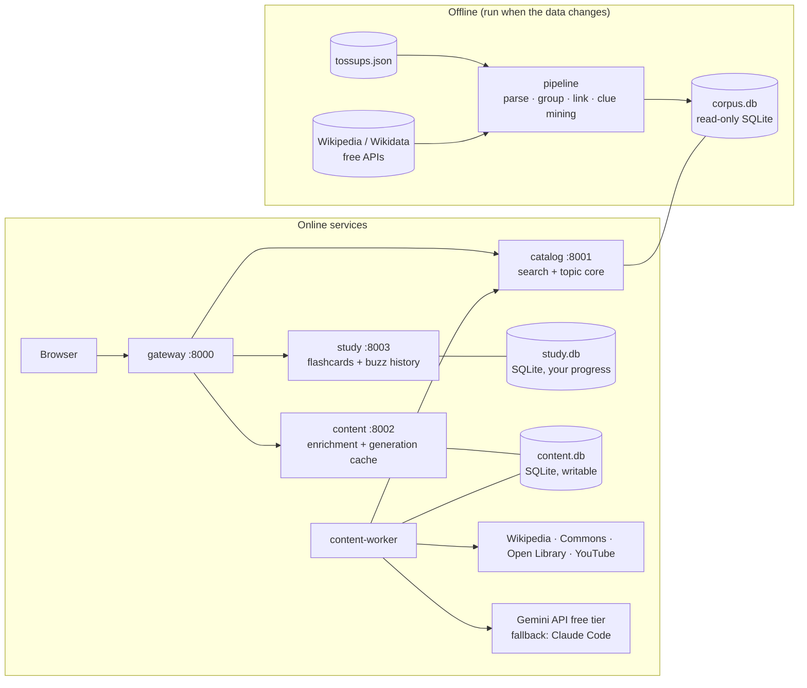
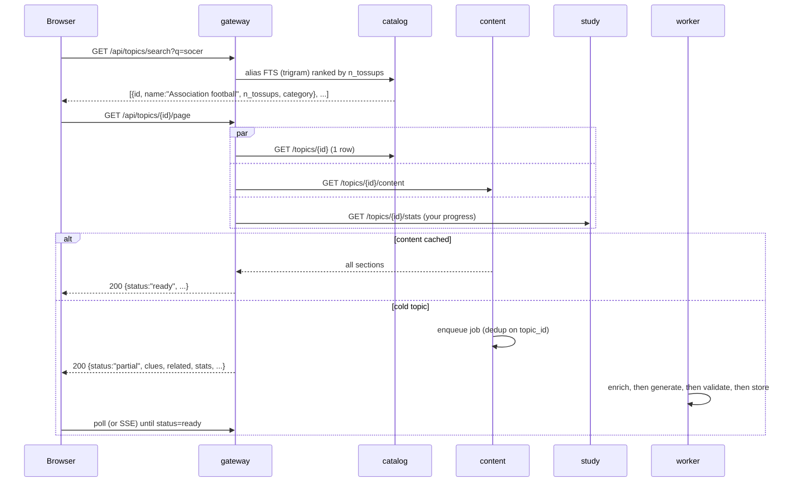

# Topic Explorer: Architecture & Build Plan

A user searches for a topic (e.g. "soccer"). The system finds every quiz bowl tossup whose answer is that topic, picks the clues most worth learning, and builds a study page around them, laid out like a museum exhibit: a hook and summary, an explanation of each key clue, fun facts, two special sections chosen by category, images, a bibliography, educational videos, related topics, and colors chosen to suit the topic. Around the page sit study tools: buzzer practice on real tossups, spaced-repetition flashcards, a clue heatmap, a timeline and map, and a "don't confuse with" list.

**Two goals shape every decision below:**

1. **Lookups must be trivial.** All the hard work (parsing answers, grouping them into topics, extracting and ranking clues, linking related topics) happens once, offline, in a batch pipeline. At request time, the core page is a single primary-key read.
2. **$0 to run.** Every step that can be done without an LLM is done without one, using free data sources and local, open-source NLP. The LLM is used only for writing and for choosing colors, each piece runs **once per topic**, and the result is cached permanently. Free models do most of it, with a better model only for the hook, summary and main special section (§7.4).

---

## 1. The input data (what `tossups.json` actually is)

Measured on the file currently in the repo root:

| Fact | Value | Design consequence |
|---|---|---|
| Format | 404 MB **NDJSON** MongoDB export (one object per line, `$numberInt`/`$oid`/`$date` wrappers) | Stream it; never `json.load` it whole. Unwrap extended JSON on ingest. |
| Tossups | 187,165, from 701 sets, 2000–2026 | Small enough for SQLite on a laptop. |
| Exact duplicate question texts | 659 | Dedupe by hash of the normalized text before counting clue frequency. |
| Answers with `<u>` markup (required part) | 183,693 (98%) | The underlined text is a reliable signal for the canonical name and short aliases. |
| Answers with `[...]` alternates | 91,765 | Parse `or`/`accept`/`prompt on`/`do not accept` directives. |
| Questions with a power mark `(*)` | 115,250 (62%) | Gives a free "is this clue early?" signal on top of position. |
| Empty answers | ~875 | Drop them. |
| Trailing author tags like `<AP>` | ~890 | Strip them. |
| Distinct naive main answers | 60,185 | Shrinks after grouping (plurals, articles, aliases). |
| …with ≥3 / ≥10 / ≥50 tossups | 13,715 / 3,670 / 249 | These tiers decide which topics get pages and which are pre-generated. |
| Median question length | 121 words, ~5 sentences | About 940k candidate clues in total. |

The answer lines are messy but follow a convention. Real examples:

```
doctors [or physicians]
soccer [or association football; accept football or balɔntan or ntolatan or futbol ...]
football [accept calcio fiorentino before mention, and, if necessary, soccer] <AP>
England national soccer team [prompt on The Three Lions; do not accept or prompt on "United ...]
```

They also show why "find all questions where the answer is soccer" needs care. A plain text search for "soccer" in answer lines matches 70 different answer lines, including FIFA, the World Cup, stadiums, and the Tham Luang cave rescue. Those aren't questions *about* soccer; they're **related topics**.

> ⚠️ `tossups.json` is untracked and 404 MB, which is over GitHub's 100 MB per-file limit. Move it to `data/raw/` and gitignore `data/` before the next commit (§10, step 1).

---

## 2. System overview



| Component | Replaces | Owns | Calls out to | Costs money? |
|---|---|---|---|---|
| `pipeline/` (batch CLI, not a server) | — | Builds `corpus.db` | Wikipedia/Wikidata (free) | No |
| `catalog` service | `service-a` | `corpus.db` (read-only) | Nothing | No |
| `content` service (API) | `service-b` | `content.db` (cache + job queue) | Nothing on the request path | No |
| `content-worker` (runs on your Mac while Claude Code is in a chain, see §7.4) | — | Writes `content.db` | Free APIs + Gemini (+ Claude Code fallback) | No |
| `study` service | — (new) | `study.db`: your cards, review schedule and buzz history | Nothing | No |
| `gateway` | (existing) | Nothing | catalog, content, study | No |

**Why this split:**
- `catalog` is pure, fast and immutable. It ships with its database file and has no outbound dependencies, so it can never be slowed down or broken by Wikipedia, YouTube or the LLM.
- `content` holds everything fetched or generated, which is slow, can fail, and in one case costs money. A worker processes jobs so no user request ever waits on an LLM call while holding a connection.
- `study` holds the only data that can't be rebuilt: your progress. Keeping it apart from the regenerable caches makes it simple to back up (one file) and safe from pipeline rebuilds.
- Four small services plus a worker is about the right size for a one-person project. Splitting enrichment, generation and theming into separate services would add deployment overhead without isolating anything useful.

**Why SQLite (for now):** The corpus is read-only and built offline, so a SQLite file is the simplest and cheapest store possible, with zero hosting cost, and it can be baked into the catalog image. `content.db` has one writer (the worker) and runs on one host, so SQLite in WAL mode is enough. Move `content.db` to Postgres only when you run more than one host. Back up `study.db` nightly with SQLite's online backup (`sqlite3 study.db ".backup ..."`) to a synced folder; nothing else needs backing up because it can all be rebuilt.

---

## 3. Offline pipeline (the important part)

A workspace package `pipeline/` (`hortum-pipeline`) exposes a CLI with one command per stage. Each stage reads the previous stage's output, is **idempotent**, and stamps its output with a `PIPELINE_VERSION` so downstream caches know when to invalidate.

```
make pipeline         # runs all stages
hortum-pipeline ingest | parse-answers | group | link | facts | clues | cluster | score | relate | confuse | snapshot
```

Everything here is free: Python, `selectolax` (HTML), `unidecode`, `inflect` (singularizing), spaCy `en_core_web_sm` (noun phrases and named entities), `sentence-transformers` `all-MiniLM-L6-v2` (local, CPU), `scikit-learn`, `pyahocorasick`, and the Wikipedia/Wikidata public APIs with an on-disk HTTP cache. I expect a full run to take a few hours on a laptop, mostly in the network-bound linking stage, which is cached so re-runs are fast.

### Stage 1: `ingest`
- Stream NDJSON, unwrap extended JSON, drop empty answers, strip author tags.
- Dedupe by `sha1(normalized question text)`, keeping the copy with the most metadata. Record duplicates in `tossup_aliases` so nothing is lost.
- Load into `tossups` and `sets`.

### Stage 2: `parse-answers` → structured answer lines
Parse the **HTML** answer (not the sanitized one) so underline and bold information is preserved. Packet headers run into the answer line are dropped ("Tay-Sachs disease PACE NSC 2011 Edited by … Packet 16"). The cut starts only at a known tournament name followed by a year. Editor initials escaped in the source ("spiders &lt;RB/MJ&gt;") are dropped too. For each tossup, produce:

```json
{
  "main": "doctors",
  "required": ["doctor"],
  "accept": ["physicians"],
  "accept_conditional": [{"text": "soccer", "condition": "if necessary"}],
  "prompt": ["World Cup"],
  "reject": ["United Kingdom"],
  "parse_confidence": 0.95
}
```

- A small hand-written tokenizer for `[...]` / `(...)` blocks that splits on `;` and recognizes the directives `or`, `accept`, `prompt on`, `anti-prompt on`, `do not accept`/`reject`, and conditions (`before "X"`, `until mentioned`, `if necessary`).
- `required` comes from the underlined spans, which is how "Martin Arrowsmith" also yields the alias "Arrowsmith".
- Anything unparseable gets low confidence and is kept. Report a coverage percentage per run and iterate on the parser against the worst cases.

### Stage 3: `group` → candidate topics
Normalize the main answer (casefold, `unidecode`, strip leading articles and punctuation, singularize), then group **only on the normalized main answer within a compatible category**.

> **Never merge groups because they share an `accept` alias.** Accept chains over-merge: "football" is accepted for both soccer and American football answers, and following that chain would fuse them into one topic. Accept and prompt strings become **aliases** of a topic, never merge keys.

The same main string in very different categories (e.g. "Mercury" in Science/Astronomy, Science/Chemistry and Mythology) starts as separate candidates, and Stage 4 settles them.

### Stage 4: `link` → canonical topics via Wikidata
This is the step that makes grouping actually work, and it's free:
1. **Direct title lookup** (20 answers per request): each answer is looked up as a Wikipedia title, following redirects ("Soccer" → "Association football") and also trying it without a leading "the". Full legal names are also tried in short form ("Oscar Fingal O'Flahertie Wills Wilde" → "Oscar Wilde", "General Benedict Arnold" → "Benedict Arnold"; "II" is kept). A short-form hit earns a smaller bonus, and only if the page reads like a biography and shares text with the questions; otherwise it's scored as any search hit. This added about 100 links. In a judged sample, 19 of 20 new links were right (the miss: George S. Patton "III" → his grandson IV), and no existing link was lost. A hit is the strongest candidate. If the answer's own title is a **disambiguation page** ("Mercury", "Doctor", "Bliss"), the name alone proves nothing, and every candidate must agree with the questions.
2. **Search:** for each group, one Wikipedia search returns the top hits with their intro text and Wikidata ID. When the evidence is weak, a second search adds a category hint ("The Republic philosophy"); hits found only that way get a small penalty.
3. **Scoring:** TF-IDF similarity between each candidate's intro and the group's own questions, plus a bonus for a direct hit (largest), an exact title match on the main answer (a plain title beats a parenthesized one), or a match on an accepted alternate or part of the title (smaller). An exact match on Wikipedia's main article needs little or no text similarity, so "France" asked in music questions still links to France.
4. **The right kind of page** (added in the Phase 1 cleanup). A title match can still be the wrong kind of thing: "Barabas" (Marlowe's Jew of Malta) is a redirect to Barabás, a village in Hungary; *Richard III* questions about the play matched the 1995 film; "Wynton" is a given-name page; battles matched the towns they're named for.
   - **How the mismatch is spotted:** each candidate's first sentence gives its kind ("X is a [adjectives] **village / film / given name / album**"). The questions' giveaways say what they want ("name this **play**", "this **city**", "give this **surname**").
   - **The penalty:** a film, settlement, name page or recording the giveaways never ask for loses 0.2, and needs real text similarity even on an exact title.
   - **The limit:** the demotion may only move a link to a page whose own title matches the answer (the play, not the film). If the runner-up only partly matches, the original order stands. Partial matches winning by default were as often wrong as right ("Michael" → Michael Jackson, "lontano" → *Mefistofele*).
   - **Measured result:** against the earlier links, 153 groups were relinked and 195 unlinked; none were newly linked. In a random sample of 50 changes, about 35 were improvements and 7 regressions. Examples: *The Mayor of Casterbridge* and *Holes* moved from their films to the novels, surname questions went to surname pages, and wrong films, villages and name pages were dropped.
5. **Groups that resolve to the same Wikidata item merge into one topic.** This is where "soccer" and "association football" come together correctly, and Mercury splits into the planet and the element.
6. Answer forms (main, underlined parts, accepted alternates) and the Wikipedia title go into `topic_aliases`, so a search for "futbol" or "association football" finds the topic. Stage 4b adds Wikidata's aliases.

On the full corpus (October 2026): 89% of groups link, giving 38,228 linked and 7,626 local topics. A random 50-link spot check found 45 correct; the misses were all one- or two-question oddities ("therm-", "privilege").

Unlinked groups (common for categories like "doctors" or "stadiums") stay as topics with a local ID (`local:<slug>`); unlinked groups with the same normalized answer merge only when their questions are about the same thing. That means TF-IDF cosine ≥ 0.05, chained through shared members: plant roots and polynomial roots stay apart, while five "playing chess" groups from five categories join. With "merge them all", on the 265 answers this now splits, a judged sample of 20 was right 8 times (the same concept asked in different places); splitting gets 12 right ("Job" the role vs the biblical Job, a lock vs Belinda's lock of hair). Most remaining over-splits are "give this first name" questions. Wikimedia **refuses** requests whose `User-Agent` lacks contact details (a URL or email), so `link` and `facts` won't start until `PIPELINE_WIKIMEDIA_USER_AGENT` has one. Requests are serial and cached on disk, and `--max-requests N` caps new requests per run (cached ones are free), so a long first run can be split across sessions. Wikidata facts are cached per ID, so re-linking only fetches facts for newly linked topics.

**Wrong links (contamination).** An answer group can be linked to a topic it isn't about: a generic word ("rings" → *The Lord of the Rings*), a place a work is named after ("Vienna" → *Vienna Secession*), a whole set under one member ("piano concertos by Beethoven" → *Piano Concerto No. 5*), a bigger subject ("Lewis and Clark expedition" → *Meriwether Lewis*), or another sense of a word ("translation" in physics). String rules can't tell these from legitimate variants ("snakes" → *Snake*, "Paris, France" → *Paris*), so the content service's first-open AI pass judges each topic's answer groups, with guardrails (a group naming the topic in its own subject always stays). Its decisions are exported to `pipeline/overrides/links.jsonl` and applied here on every rebuild. Groups whose own questions mix two meanings ("Ajax" for both Ajaxes) still need per-question judgment.

### Stage 4b: `facts` → dates and places from Wikidata
For every topic with a QID, fetch its Wikidata entity in bulk (`wbgetentities`, 50 IDs per request, so ~800 requests for the whole corpus, cached on disk) and keep:
- **Dates:** point in time (P585), start/end time (P580/P582), inception/dissolved (P571/P576), birth/death (P569/P570), publication date (P577). Keep Wikidata's **precision** (day, year, decade, century), so "c. 1300" isn't drawn as 1 January 1300, and handle BCE dates.
- **Places:** coordinates (P625), or, if the topic isn't itself a place, the coordinates of its location (P276), birthplace/deathplace (P19/P20) or country (P17), resolved in a second bulk pass.
- The Wikidata one-line **description**, used as a hover label everywhere a topic is mentioned.

### Stage 5: `clues` → split questions into clues
A quiz-aware splitter: abbreviations ("Dr.", "St.", "No. 9"), initials ("T. H. Morgan", "W.E.B."), and "!"/"?" inside quotations don't end sentences, and the power mark `(*)` is removed before splitting, so "Dr. (\*) Bledsoe" stays one sentence. Sentences over 40 words split again at semicolons. Each piece gets a **kind**: `clue`, `giveaway` (the whole sentence holding "For 10 points", "For 15 points", "For the point" or "FTP", and anything after it; with no such phrase, the last sentence; only a one-sentence question keeps the part before the phrase as its clue), or `note` (moderator notes, "Two answers required."). `question_layout` stores each question's clean text and power position. For every clue:

| Field | Meaning |
|---|---|
| `char_start`, `char_end`, `word_start`, `word_end` | Exact span in the clean text, so buzzer practice can map "you buzzed at word 37" to the clue being read |
| `position` | `char_start / len(text)`; 0 is the lead-in, 1 is the end |
| `in_power` | Starts before `(*)` |
| `kind` | clue, giveaway or note |
| `key_terms` | Capitalized names (allowing "of", "van"...), quoted titles and long numbers, e.g. `T. H. Morgan`, `Battle Royale`, `1,369`. Rule-based for speed and no heavy dependencies; spaCy remains an option if Stage 6 needs lowercase technical terms. |

On the full corpus (October 2026): 869k clues, 187k giveaways, 3k notes in about two minutes; every span reproduces its text exactly, all 114,840 power marks are located, every question has a giveaway, and 0.15% of clues are fragments.

### Stage 5b: `terms` → each topic's clues, ranked by how many questions name them
The topic page's clues. A clue is a term the questions name: a proper noun or title ("Nelson Miles", "The Mysterious Affair at Styles"), a quoted term, or a noun phrase ("circumambulation rituals"). Giveaway sentences never count.
- **Extract:** the key terms from Stage 5 plus spaCy (`en_core_web_sm`) noun phrases for every clue sentence. spaCy runs once per sentence (about 25 minutes for 870k, three worker processes) and its output is cached in `data/cache/terms`, so re-ranking takes minutes.
- **Clean:** pronunciation guides and possessives removed; numbers alone, long quotations, dangling fragments ("stream of"), capitalized adjectives ("Mexican troops"), generic words, stand-ins for the answer ("this novel") and the answer's own names are never clues; "It's not X" doesn't count for X.
- **Merge spellings within a topic:**
  - folded the same way (case, accents, plurals, a leading article)
  - titles and middle initials dropped ("General Nelson A. Miles" → "Nelson Miles")
  - a short form inside exactly one longer clue, and not used more than it, joins it ("Miles" → "Nelson Miles"; "Cascades" → "Cascade Mountains", since a geographic word doesn't make a new clue), but not across a possessive ("Burnside" ≠ "Burnside's Bridge") and not when the short form is itself a different known topic
  - one spelling apart ("murti"/"murtis", "battle royal"/"battle royale")
  - names of the same Wikidata topic ("Filiki Eteria"/"Friendly Society")
- **Rank purely by frequency:** distinct questions naming the clue, then sets, then mentions. No rarity weighting.
- **Store** the top 100 per topic in `topic_clues`: label (the spelling questions use most, completed when cut off), every spelling with counts, question/set/mention counts, mean/median/earliest position and a histogram, share in power and in the last line, years, difficulty, trend, and the clues it most often shares a sentence with. `topic_clue_sentences` links each clue to its sentences, and `sentence_clues` gives each sentence its best-ranked clue (practice uses it to know which clue was being read at a buzz).
- The page shows the top 10 and a **Show 5 more** button (`GET /topics/{id}/clues?offset=&limit=`). Two names for one fact ("Cassetti"/"Ratchett") stay separate clues for now; the stored co-occurrences show them as "often with", and a later choice can fold them.

### Stage 6: `cluster` → the same fact, worded differently
Different questions phrase one fact many ways ("invited to the McGurk Institute by Max Gottlieb" vs. "his mentor Gottlieb brings him to McGurk"). Within each topic:
- Embed clues with MiniLM (`all-MiniLM-L6-v2` via fastembed, local and free; onnxruntime is pinned below 1.20 on Intel Macs, which newer releases dropped). Embeddings are cached per clue text, so the ~2-hour first run happens once.
- Similarity = cosine + 0.2 per shared key term, then average-linkage clustering at distance 0.6.
- The **representative** clue is the medoid, and the cluster's **label** is its most common key term.

The method was chosen against the labeled clues (`pipeline/eval/labeled_clues.yaml`): pairwise F1 on same-fact clue pairs was 0.76 for MiniLM with the term bonus vs 0.60 for the best TF-IDF setting, which rarely groups paraphrases. On the full corpus: 868,752 clues in 424,000 clusters, of which 60,420 recur in 3+ questions; `verify` re-measures F1 on every run (0.741 over 73,849 labeled pairs) and fails below 0.70.

### Stage 7: `score` → "high-impact" clues
The goal is clues **common enough to be worth knowing** and **early enough to win the buzz**. For each clue cluster:

```
frequency    F = sqrt(distinct sets)                 # common across the circuit, not repeated in one set
earliness    E = 1 - median(position) (+ power bonus)
last line    L = share of clues in the last line before the giveaway
specificity  S = idf(key terms across all topics)     # stored; weight 0 after tuning
impact       = F * E ** 0.25 * S ** 0 * (1 + 0.3 * L)
```

- **Last-line bonus:** the line just before the giveaway holds the well-known clues, so a small bonus keeps the picks from being only niche lead-in facts. Sweeping 0 / 0.1 / 0.2 / 0.3 / 0.5, 0.3 scored best on the labels (precision@5 0.940, recall@10 0.788; 0.953 and 0.780 after the label fixes) and moved last-line picks from 20% to 22%. For topics asked 3+ times, picks split 36% lead-in, 42% middle and 21% last line. 96% of those topics have a last-line clue in their top 10, and none has a top 10 that is all lead-ins. Last-line picks average 4.2 sets, lead-in picks 2.3.
- **Filters:** at least 2 distinct sets (1 for topics with fewer than 6 tossups), and not made only of the topic's own names.
- **Selection:** up to 10 by maximal marginal relevance (λ = 0.7). Redundancy is measured **relative to the topic's own baseline similarity**: every clue about one novel resembles every other, so raw similarity treated common clues as duplicates of each other.
- **Heatmap statistics** (stored on each cluster for §8.3): a 10-bin histogram of positions, share in power, counts per difficulty band (unrated, middle school 1, high school 2–5, college 6–9, open 10), first and last year seen, and a trend label (`rising`, `steady`, `fading`): the cluster's share of the topic's most recent third of questions vs the topic's own.
- **Display label:** the cluster's most common key term found in at most 50 topics, else the representative clue's opening words ("Peace" alone says nothing).
- **Tuning:** `hortum-pipeline eval-clues` scores the picks against `pipeline/eval/labeled_clues.yaml` (precision@5: share of the top 5 that match a labeled clue; recall@10: share of labeled clues found in the top 10). A sweep chose the weights above (precision@5 0.913, recall@10 0.798, before the last-line bonus and before the whole giveaway sentence was excluded from clues), under a tracer guard: *Invisible Man*'s top 10 must include Ras the Exhorter (38 sets, mid-question) and the Battle Royal. The first-guess formula (log frequency, linear earliness) ranked 6-set lead-in trivia above them. A pick matches a label only through its label, key terms, representative and five members, so a big merged cluster isn't credited with every fact its members mention.

### Stage 8: `relate` → related topics
"Clues that are answers to their own questions." Every clue and giveaway is scanned for other topics' names; each hit is a directed mention *topic A's question names topic B*, stored with its span (`clue_mentions`) so the page can link the clue text. This is how soccer's page links to FIFA and the FIFA World Cup.

Matching is token-based and longest-first ("FIFA World Cup" isn't also "World Cup"). The hard part is names that mean something else in context, and every rule below exists because a real link went wrong without it:

- **Which names:** main answers, Wikipedia titles and Wikidata aliases, plus accepted/required answer parts seen in more than one answer line. Soccer accepts "What We Think" once; *Midnight's Children* requires "main characters" once. A name must have 4+ characters and not be a bare number ("1984"). It can't start with an article or end in a function word ("existence of"). A lowercase name found in more than 300 topics' questions is a generic phrase ("18th century") and is dropped.
- **Capitalization:** a capitalized name must appear capitalized ("What is your name?" isn't the film *Your Name*). It can't sit inside a longer name ("Dr. **Bledsoe**" isn't the NFL quarterback, "Alfred **Sturtevant**" isn't Aaron Paul's birth name). A one-word name must be capitalized in most of its mid-sentence uses across the corpus, which drops "water" and "power".
- **Strong vs weak names:**
  - **Strong names** match anywhere: an all-caps one-word title ("FIFA"), the topic's own lowercase name ("Calvin cycle"), or a capitalized multi-word alias.
  - **Weak names** count only when both topics share a category: other one-word names ("Sybil" in *Invisible Man* isn't Sybil Fawlty) and lowercase Wikidata extras ("black man").
- **Shared names:**
  - **Multi-word names** go to the owner in the question's category: "Battle Royale" in a literature question is the battle royal, not the film. Among several such owners, the one whose own name it is wins ("Calvin cycle", which photosynthesis also accepts). Next comes the topic whose Wikipedia title it is; otherwise the name is skipped.
  - **One-word names** go to the in-category owner only when it's that topic's own name: "the Brotherhood" yes, but not "Columbia" claimed by the space shuttle in a biology question. Otherwise only an all-caps title keeps it ("FIFA").
- **Scoring:** `log(1 + questions of A naming B) * idf(B) + 0.5 * log(1 + questions of B naming A) * idf(A)`, where `idf(X) = log(topics / topics whose questions name X)`. A topic needs 2+ questions of support (1 for topics with fewer than 6 questions) and keeps its top 12. A **hub** (named in more than 150 topics' questions: countries, "American", "World War II") must appear in at least 3 of the topic's questions and a quarter of them. Without that rule, "American" sat in 319 topics' lists.
- **Why:** each link stores an example clue, preferring a real clue from the most commonly asked cluster over the giveaway.

On the full corpus (October 2026): 652k mentions and 291k links. 99.9% of topics with 10+ questions have related topics. `verify` checks:
- every mention span reads as its name
- no self-links
- every link's example clue names the pair
- 14 hand-checked links are present (soccer → FIFA and the World Cup, Dumas → *Monte Cristo*, …)
- 9 known wrong links stay absent (the film, the quarterback, the space shuttle, …)
- the tracers

**Audits of 40 random top-5 links:**
- An intermediate version scored 38/40. Its two errors led to the answer-line weight rule.
- The final version scores 39/40, i.e. precision ≥ 89% at 95% confidence. The one miss is *The Rime of the Ancient Mariner* → *Wedding*, from "the Wedding-Guest".

Known gaps:
- **A one-word surname in the same category can still mean someone else:** "Huxley" in *Axon* is Andrew, not Thomas Henry.
- **Skipping shared one-word names costs a few true links,** such as Ganges → Yamuna.

### Stage 9: `confuse` → "don't confuse with"
Candidate pairs come from three signals. Confusion is symmetric, so each topic keeps its top 5 pairs, each with its evidence:

| Signal | How | Example |
|---|---|---|
| **Answer-line rejects** | A reject entry that *is* another topic's name, or a name covering at least half the entry. The question's own topic never counts as rejected, which settles shared names. | mitosis ↔ meiosis, soccer ↔ American football, *Invisible Man* ↔ Wells's *The Invisible Man* (31 rejects) |
| **Same name** | Titles that are the same name once the parenthetical goes. Both topics need 2+ questions, and at most 8 topics may share the name. | Mercury (planet / element / god), Narcissus (myth / plant), *Vertigo* (film / condition) |
| **Look-alike names** | A letter or two apart in the same category, *and* clue centroids at least 0.6 alike. Names differing only in digits don't count. | Iran ↔ Iraq, North ↔ South Dakota, alkane ↔ alkene, Henry I ↔ Henry II |

`score = log(1 + rejects, either way) + 1.0 * same name + 0.5 * look-alike`.

**What was tried and dropped, with evidence:**
- **Prompts.** They mostly name broader terms ("primates" for monkeys, "fly" for *Drosophila*), which is hierarchy, not confusion.
- **Aliases as "same name".** Answer lines accept near-synonyms ("boiling" for vaporization) and parts of overlapping answers ("Allende" for the 1973 coup). They also group main answers under events named after them ("Joseph Smith" under his killing). 4 of the 6 errors in a 40-pair audit came from this.
- **Look-alike names without the similarity gate.** About half were unrelated pairs: shale/whale (0.23), leaf/lead (0.33), poker/*Joker* (0.33). Real look-alikes score 0.73–0.86.
- **Clue overlap on its own.** A topic's nearest neighbors by clue centroid are siblings, not confusions: Poe → Shakespeare 0.93, electron → photon 0.94, Austria → Italy 0.89. Those scores sit above the 99th percentile of same-category pairs (0.81), so no threshold separates confusions from siblings.

On the full corpus (October 2026): 3,410 rejects name another topic, plus 400 same-name pairs and 176 look-alike pairs (of 282 similar names). That gives 4,798 confusion links over 3,701 topics; most topics have nothing confusable, so that is expected. The stage runs in about 2½ minutes.

**Audits of 40 random pairs:**
- **First version:** 34/40.
- **Final version:** 37/40, so precision ≥ 80% at 95% confidence. The three misses are two duplicate topics left over from Phase 1 (*making tea*, *infinite*) and one odd answer-line reject.

`verify` checks:
- every pair's evidence supports its reasons
- 18 hand-checked pairs are present both ways
- 7 known wrong pairs stay absent
- the tracers

### Stage 10: `snapshot` → one row per topic
Denormalize everything the page needs from the corpus into `topic_snapshots(topic_id, json, schema_version)`. **The catalog's topic endpoint is a single primary-key read with no joins.** Every topic gets a record, even one asked once: search can find any answer, so every answer has a page. Topics asked fewer than 3 times are marked `thin` so the page can say "rarely asked".

The record holds:
- **`topic`:** id, slug, name, Wikidata/Wikipedia ids, description, category and stats. Display aliases are Wikipedia and Wikidata names plus capitalized answer-line names seen twice. Answer lines also accept descriptions like "main character", which aren't names.
- **`clues`:** the ranked picks, each with a label, text, up to 3 example wordings from other sets, set and question counts, impact and the heatmap.
  - **The card's text and examples name its label.** A big cluster can hold a neighboring fact ("Ras the Exhorter" merged with Brotherhood clues), so wordings that contain every content word of the label come first, then the newest.
- **`related`:** each link with a plain-language "why" and its example clue.
- **`confusions`:** reasons, evidence, and distinguishing clues. Those are each side's top clue labels that the other side doesn't share: Wells's *The Invisible Man* offers "Griffin, Thomas Marvel, Port Burdock".
- **`timeline`:** the most precise Wikidata date per property, for the topic and its related topics.
- **`map`:** places with coordinates.
- **`tossup_ids`:** newest first.

Generated sections (hook, summary, clue explanations, fun facts, special sections, colors) live in the content service and are merged in by the gateway.

On the full corpus (October 2026):
- **Records:** 45,523, of which 32,143 are thin. They total about 390 MB, averaging 8.5 KB, and are built in about 3 minutes.
- **Checks:** `verify` confirms:
  - every topic has a current record whose counts match the source tables
  - clue cards name their labels
  - no record is over 200 KB
  - a page read is fast (p95 under 5 ms)
  - the tracers' final pages

Catalog endpoints, also reachable through the gateway at `/api/catalog/...`:
- **`GET /topics/{id-or-slug}`:** the stored JSON, served without re-parsing.
- **`GET /topics/{id}/tossups?limit=&offset=`:** questions newest first, with clean text, power position, answer and clue spans.
- **`GET /practice/next?topic=&category=&difficulty_min=&difficulty_max=&exclude=`:** a random matching question that skips ones already seen.

---

## 4. Data model

### `corpus.db` (built by the pipeline, read-only, owned by catalog)

```sql
sets(id, name, year, is_standard)
tossups(id, text_hash, set_id, packet_name, packet_number, number, category, subcategory,
        alt_subcategory, difficulty, question_text, question_html, answer_text, answer_html,
        n_reports, power_word_index)
tossup_duplicates(tossup_id, kept_id)
answer_parses(tossup_id, line_key, main, main_norm, parser_main, required JSON, accept JSON,
              prompt JSON, reject JSON, notes JSON, issues JSON, parser_confidence, confidence,
              source /* parser|override|excluded */, parser_version)
candidate_groups(id, norm_key, category, subcategory, display_name, n_tossups, n_sets)
tossup_groups(tossup_id, group_id)
group_links(group_id, status /* linked|no_match|skipped */, qid, title, score, similarity, candidates JSON)
tossup_topics(tossup_id, topic_id)
topics(id, slug, display_name, wikidata_qid, wikipedia_title, description, primary_category,
       n_tossups, n_sets, difficulty_min, difficulty_max, first_year, last_year)
topic_aliases(topic_id, alias, alias_search, source /* main|required|accept|title|wikidata */, weight)
topic_aliases_fts  -- FTS5, tokenize='trigram' over alias_search: typo-tolerant search
clues(id, tossup_id, topic_id, ordinal, text, char_start, char_end, word_start, word_end,
      position, in_power, is_giveaway, key_terms JSON, cluster_id)
clue_clusters(id, topic_id, label, key_terms JSON, representative_clue_id,
              n_tossups, n_sets, median_position, share_in_power, share_last_line, specificity, impact, rank /* NULL if not top-K */,
              position_hist JSON, difficulty_hist JSON, first_year, last_year, trend)
clue_mentions(clue_id, topic_id, mentioned_topic_id, alias, char_start, char_end)
related_topics(topic_id, related_topic_id, rank, score, n_questions, n_reverse, example_clue_id)
topic_facts(topic_id, kind /* date|place|description */, property, value JSON /* time+precision | lat,lon,label | text */)
confusions(topic_id, other_topic_id, rank, score, reasons JSON /* reject|same_name|lookalike */, evidence JSON)
topic_snapshots(topic_id PRIMARY KEY, json, schema_version)
```

### `content.db` (writable, owned by content)

```sql
enrichments(topic_id, kind /* wiki|images|books|videos */, payload JSON,
            source_version, fetched_at, PRIMARY KEY (topic_id, kind))
generations(topic_id, kind /* summary|clues|fun_facts|special_a|special_b|theme|book_blurbs */,
            model, prompt_version, input_hash, payload JSON,
            input_tokens, output_tokens, cost_usd, created_at,
            PRIMARY KEY (topic_id, kind))
jobs(id, topic_id, kind, status /* queued|running|done|failed */, priority,
     attempts, last_error, not_before, created_at, updated_at)
spend(day PRIMARY KEY, usd)
```

A generation is reused as long as `(prompt_version, input_hash)` hasn't changed. Bumping a prompt version regenerates lazily, not all at once.

### `study.db` (writable, owned by study; back this one up)

```sql
followed_topics(topic_id PRIMARY KEY, name, added_at)
cards(card_id PRIMARY KEY /* stable hash, see §8.2 */, topic_id, kind /* clue|reverse|missed */,
      front, back, source_ref JSON, created_at, suspended)
card_state(card_id PRIMARY KEY, due, fsrs JSON /* fsrs.Card.to_dict(): state, step, stability,
           difficulty, due, last_review; review counts come from reviews */)
reviews(id, card_id, rating /* 1 again | 2 hard | 3 good | 4 easy */, reviewed_at, elapsed_days)
buzzes(id, tossup_id, topic_id, word_index, position, clue_ordinal, clue_cluster_id,
       result /* correct|incorrect|no_buzz */, in_power, answer_given, judged_by /* auto|self */,
       created_at)
```

Cards store their own `front` and `back` text, so a pipeline rebuild that changes clue IDs never breaks your deck.

---

## 5. Request flow (the "easy lookup")



- **Search:** FTS5 trigram over aliases gives typo tolerance ("socer"), prefix matching and alias hits ("futbol"). Rank by match quality × `log(n_tossups)`. Ambiguous names return several topics, labeled by category (Mercury the planet, Mercury the element, Mercury the god).
- **Cold topics** still render immediately with everything that's precomputed: impact clues (raw clue text), heatmap, related topics, confusions, timeline, map, stats, and buzzer practice. The written sections fill in when the worker finishes, typically within a minute.
- The gateway composes the page (backend-for-frontend), so the browser makes one call.

### Page contract (abridged)

```json
{
  "status": "ready",
  "topic": {"id": "Q…(Wikidata QID)", "name": "Association football", "aliases": ["soccer", "football", "futbol"],
            "stats": {"n_tossups": 41, "n_sets": 37, "difficulty": [2, 9], "years": [2004, 2025]}},
  "hook": "Two or three sentences to pull you in.",
  "summary": {"markdown": "... [[clue:1|Calcio fiorentino]] ...",
              "source": {"title": "Association football", "license": "CC BY-SA 4.0", "url": "..."}},
  "fun_facts": [{"text": "...", "source_sentence": "..."}],
  "special": [{"kind": "timeline_events", "data": {...}}, {"kind": "be_there", "markdown": "...", "diagram": {...}}],
  "clues": [{"rank": 1, "label": "Calcio fiorentino", "impact": 0.83, "median_position": 0.18,
             "examples": ["...", "..."], "one_line": "...", "explanation": "...",
             "heatmap": {"position_hist": [0, 3, 5, 2, 1, 0, 0, 0, 0, 0], "in_power": 0.9,
                         "difficulty": {"hs": 4, "college": 7, "open": 0}, "years": [2009, 2024], "trend": "steady"}}],
  "confusions": [{"id": "Q…", "name": "American football", "reason": "same_name",
                  "distinguishing_clues": {"this": ["..."], "other": ["..."]}, "tip": "..."}],
  "timeline": [{"id": "Q…", "label": "...", "start": {"time": "1863", "precision": "year"}, "end": null, "is_topic": true}],
  "map": [{"id": "Q…", "label": "...", "lat": 51.5, "lon": -0.12, "role": "topic|related|clue_place"}],
  "practice": {"n_tossups": 41, "your_stats": {"buzzes": 12, "accuracy": 0.75, "median_buzz_position": 0.61}},
  "bibliography": {"highlighted": [{"title": "...", "author": "...", "year": 2006, "level": "intro",
                                    "blurb": "...", "cover": "https://covers.openlibrary.org/..."}],
                   "more": [...], "wikipedia": {...}},
  "videos": [{"youtube_id": "...", "title": "...", "channel": "CrashCourse", "duration_s": 642}],
  "related": [{"id": "Q…", "name": "FIFA World Cup", "why": "mentioned in 9 clues"}],
  "theme": {"light": {"bg": "#...", "surface": "#...", "text": "#...", "accent": "#...", "accent2": "#...", "muted": "#..."},
            "dark": {...}, "header_tint": "#...", "font_pairing": "classical-serif", "hero_image": {...}}
}
```

---

## 6. Enrichment (free data sources, no LLM)

The worker fetches these and caches them in `enrichments`. Wikimedia and Open Library both ask for a descriptive `User-Agent`.

| Section | Source (all free) | What we take |
|---|---|---|
| **Wikipedia article** | `action=query&prop=extracts&explaintext` + `action=parse` (sections) | Plain text of the lead and main sections, capped at ~6k tokens, used as grounding for the summary. |
| **Images** | `prop=pageimages`, `prop=images` + `imageinfo&iiprop=url\|extmetadata`, Wikidata `P18` | Up to ~10 candidates with caption, dimensions and **license/attribution**. |
| **Bibliography candidates** | (1) The article's *Further reading*, *Bibliography* and *Sources* sections plus `{{cite book}}` templates (title, author, year, ISBN, how often cited). (2) Open Library `search.json` (subject and title search: `edition_count`, `ratings_count`, `want_to_read_count`, `cover_i`). | Merge and dedupe by ISBN or work key, then rank by `cited_in_article×3 + log(edition_count) + log(1+ratings_count)` and keep the top ~15. Add category-specific free references: Stanford Encyclopedia of Philosophy for philosophy, MacTutor for mathematicians, Britannica for everything. |
| **Videos** | YouTube Data API v3 (free key; default quota **10,000 units/day**, `search.list` = 100 units, `videos.list` = 1) | See below. |
| **Clue grounding** | Wikipedia lead (~150 tokens) for each impact clue whose key term links to a topic or article | Gives the clue explanations facts to work from instead of guesses. |

**Videos, specifically.** No LLM is needed, and they're ranked deterministically:
1. Run `search.list(q="<topic name> <disambiguator>", type=video, videoEmbeddable=true, maxResults=50)` and keep results from an **allowlist of educational channel IDs** (CrashCourse, Khan Academy, TED-Ed, PBS Eons/Space Time, Kurzgesagt, Smithsonian, Great Courses, SciShow, Overly Sarcastic Productions, Kings and Generals, and so on). The list lives in config.
2. If fewer than 2 results survive, run a second search restricted to `videoCategoryId=27` (Education).
3. Fetch `videos.list` for duration and views (1 unit). Keep 4–40 minute videos and rank by allowlist priority, then title match, then views. Take 2–3.

The quota allows ~50–100 new topics a day, which is plenty for one user. Cache results permanently and show a "videos coming soon" state if the quota ever runs out.

---

## 7. Generation and the exhibit page

Each topic page is laid out like a museum exhibit (in the spirit of DK Eyewitness): you walk through numbered rooms, each immersing you in one side of the topic with images, timelines, diagrams, videos and explanations. **The AI only writes and chooses colors; facts and media come from free sources, and code checks everything the AI returns.**

### 7.1 What each page has

| Section | Source | AI | Checked in code |
|---|---|---|---|
| **Hook** (2–3 short sentences at the top) | Wikipedia text and the top clues | Better model (with the summary) | Sentence count; length |
| **Summary** (500–750 words) | Wikipedia text, the clue list | Better model | Word count. Engaging and intuitive rather than technical (the clue section carries the depth), readable at a high-school level. Each clue from the clue section is marked in the text as `[[clue:<id>|words]]` and shown **bold**; every marked ID must be one of the page's clues. Hovering (or tapping) shows that clue's one-sentence summary and a **See more** button that scrolls to its full explanation. A clue that can't be worked in naturally after one retry just isn't bolded. |
| **Clue explanations** (200–300 words each) | Each clue's wordings, plus the Wikipedia intro of what the clue refers to (fetched free; the relate stage already knows the clue's subject) | Small model, about 5 clues per request | Word count; one per clue ID. Each also returns the **one-sentence summary** used by the summary's popups. PhD-level: what it is, how it ties to the topic, why it matters. |
| **Fun facts** (5–8) | Wikipedia text | Small model | Each must quote the source sentence it rests on, and that sentence must be in the article, so facts can't be invented. Facts should teach something and show why the topic matters. |
| **Two special sections** | By category (§7.2) | Varies | Per section (§7.2) |
| **Colors** | Topic, category, hook, the header image (sent as a small thumbnail), and colors extracted from the images by code | Small vision model | The model picks aesthetic colors that match the topic and blend with the header image and the text, not just the image's raw colors (which can be too grey or clash). It returns 6 tokens for light and dark plus a tint for the header fade. Code checks hex format and enforces WCAG AA contrast by nudging lightness only (hue and saturation kept). Cached like any generation. |
| **Header image** | The article's main image (Phase 5) | No | Code picks it by size; it fades into the page's background color. A low-resolution image gets a two-tone tint in the theme colors. |
| **Images** | Phase 5 (Commons, with license and credit) | No | SVG diagrams allowed for science and math; audio for music. |
| **Videos** | Phase 5 (YouTube) | No | — |
| **Bibliography** | Phase 5 (cited books + Open Library) | Small model: blurbs for the top 3–5 | Picks must be IDs from the real list. |
| **Confusion tips** | The confusion pair and its distinguishing clues | Small model (with the fun facts) | One sentence per confusion; IDs must match the page's confusions. |
| **Clues, heatmap, related, don't-confuse-with, map** | The pipeline (Phases 2 and 4) | No | Restyled only. |

**Diagrams are deterministic.** Wherever possible a diagram is drawn by the page from data: Wikidata (family trees, taxonomies, influence webs), fixed templates (step flow, cycle, labeled parts, comparison table, timeline) whose labels the model fills in, math typesetting (KaTeX), and interactive pieces (3D molecules, graphs, sliders). The model never draws free-form images.

News articles were considered and dropped for now.

### 7.2 Special sections by category

Sections marked ✦ are the long immersive piece, written by the better model. The rest cost no AI or only a small model. A topic's main subcategory (most common among its questions; added to the snapshot) picks its pair.

| Category | Section A | Section B |
|---|---|---|
| **History** | Timeline of events (Wikidata dates plus events pulled from the article; each date must appear in the source) | ✦ **Be there:** one moment in sights, sounds and smells |
| **Physics, Chemistry, Astronomy, Earth science** | Timeline of discoveries (Wikidata discovery dates and discoverers, plus the article) | ✦ **Deep dive:** one core concept in great detail at an intuitive high-school level, with a template diagram |
| **Biology** | Tree of life (Wikidata taxonomy) or timeline of discoveries | ✦ Deep dive on one process or structure, with a step diagram |
| **Chemistry** (extra) | 3D molecule (PubChem + 3Dmol.js) | — |
| **Math** | ✦ **Build the idea:** from a simple example to the formal statement, with KaTeX | Where it shows up: interactive graph or worked example, plus applications |
| **Computer science** | Algorithm stepper (animated) | Timeline of discoveries |
| **Literature** | Character map (from the plot summary; every name must appear in it). For authors: a bookshelf of their works (Wikidata + Open Library) | ✦ **Walk through the work**, room by room |
| **Visual arts** | ✦ **Look closer:** zoomable high-resolution image with a guided tour of details | The artist's other works (Wikidata + Commons) |
| **Music, opera, jazz** | Listening room (Commons or YouTube recordings) | ✦ **Listening guide:** what to listen for, section by section |
| **Architecture** | Floor plan and views (Commons) | ✦ Walk through the building |
| **Film** | ✦ Key scenes | Production timeline |
| **Mythology** | Family tree (Wikidata parent, spouse and child) | Depicted in art (Wikidata "depicts" + Commons) |
| **Religion** | Sacred texts (public-domain passages from Wikisource) | Spread map and timeline |
| **Philosophy** | Argument map (premises to conclusion, as a diagram) | Influence web (Wikidata "influenced by") |
| **Economics** | The model, interactive (e.g. supply and demand sliders) | Real data chart (World Bank or FRED) |
| **Psychology** | ✦ **The experiment:** setup, procedure, results, how it has held up | Timeline |
| **Linguistics** | Sounds and scripts (IPA, Commons recordings) | Language family tree (Wikidata) |
| **Geography** | By the numbers: climate chart (Wikipedia weather box) and population (Wikidata) | ✦ A traveller's route |
| **Current events** | How the story developed (timeline) | ✦ Be there |
| **Pop culture** | By the numbers | Behind the scenes |

Politics isn't its own category in the data; those questions fall under History, Current Events and Social Science.

### 7.3 The exhibit layout

- **Entrance:** full-width header image fading into the theme colors, the title as an exhibit sign, the **hook**, and a small floor plan of the rooms.
- **Room 1, Introduction:** the summary, with bold clue terms and their popups.
- **Room 2, Gallery:** images with museum-style labels (title, date, artist, credit).
- **Rooms 3 and 4:** the two special sections.
- **Room 5, The clue hall:** clue cards with their explanations and the heatmap.
- **"Did you know?" plaques:** fun facts as boxed callouts between rooms.
- **Room 6, Connections:** related topics, don't confuse with, the map.
- **Room 7, Screening room:** videos.
- **Room 8, Library:** books and reference works.
- **Exit, Test yourself:** practice and follow.

The theme only fills CSS variables and picks a font pairing by category; each room has a fixed layout of its own, like a two-page spread.

### 7.4 Requests per topic and models

Generation runs the first time a topic is opened (or when queued ahead with the CLI), and every result is cached. Each section is stored separately, so the page fills in as each arrives and one failure doesn't block the others.

| Tier | Model | Writes | Output |
|---|---|---|---|
| **Better** (1 request) | Claude Code on your plan, with Gemini (the best free model) as backup | Hook, summary, and the ✦ special section | ~2,300 words |
| **Small** (2–3 requests) | Gemini Flash or Flash-Lite; Groq or OpenRouter free models as backups | Clue explanations (in batches), fun facts, timeline events, diagram labels, book blurbs, confusion tips | ~3,500 words |
| **Small, vision** (1 request) | Gemini Flash | Colors | ~300 tokens |
| **None** | Code and free APIs | Header image, images, videos, Wikidata sections, heatmap, map | — |

Each request returns JSON matching a schema. On a failed check it retries once with the error attached; parts that still fail are marked failed and the page renders without them. Every result records its backend, model, prompt version and an input hash, so a prompt change regenerates lazily and `regenerate --where model=…` redoes pages from a model you've stopped trusting.

**Turning Claude off is one setting.** `CONTENT_USE_CLAUDE_CODE=false` removes `claude_code` from every chain, so the better tier runs on Gemini and the worker can move back into Compose. Nothing else changes: the chains, prompts and checks are shared, and pages already generated stay cached (`regenerate --where model=…` redoes them later if you want).

**Fallback chains** (`CONTENT_WRITING_CHAIN`, `CONTENT_LIGHT_CHAIN`, `CONTENT_THEME_CHAIN`): on a rate-limit or quota error the worker moves to the next backend; if all are exhausted the job waits (`not_before`) until the earliest reset. Free-tier limits change often; confirm them when building.

| Backend | Cost | Notes |
|---|---|---|
| `gemini` | $0 on the free tier | Free key from Google AI Studio. **Free-tier prompts and outputs may be used by Google**, acceptable here because the inputs are Wikipedia text and quiz clues. |
| `claude_code` | $0 within your Claude plan | Runs `claude -p` with tools off, JSON out. Needs your local login, so while it's in a chain the worker runs natively on your Mac rather than in Compose. Personal use only. |
| `groq`, `openrouter` | $0 on free tiers | Backups for the small tier. |
| `anthropic_api` (later) | Paid, with `CONTENT_DAILY_BUDGET_USD` | If the site is ever shared. |

**Before relying on it:** generate about 10 hand-picked topics across categories, read them, and tune the prompts.

---

## 8. Learning features

Everything in this section is **free**: it reuses data the pipeline already builds, runs in the browser, or stores your progress in `study.db`. The only LLM use is the optional one-line confusion tips in the light request.

### 8.1 Buzzer practice

Real tossups are revealed word by word, like a moderator reading. You buzz, answer, and the system records exactly where you buzzed.

- **Where it appears:** a "Practice this topic" button on every topic page (only that topic's tossups), plus a general practice mode filtered by category and difficulty.
- **Reading:** words appear at a configurable speed (start around 200 words per minute and adjust to taste). The power mark is shown subtly once passed. Press space to buzz, which stops the reveal and starts a short answer timer.
- **Answer checking**, using the parsed answer line from Stage 2:
  1. Normalize what you typed the same way as aliases (casefold, strip accents and articles, singularize).
  2. Exact or fuzzy match (similarity ≥ 0.85) against `required` + `accept` counts as **correct**. A match against `prompt` shows "Prompt: be more specific" and lets you try again. A match against `reject` counts as **incorrect**.
  3. You can always override with "I was right" or "I was wrong", since parsed answer lines will never be perfect. Overrides are logged as `judged_by=self`, which also gives a list of answer lines the parser should handle better.
- **After every answer**, right or wrong, the answer links to its Wikipedia article (a Wikipedia search when the answer isn't linked to one) as well as its topic page.
- **What gets recorded** (`buzzes`): the word index and position of your buzz, the **clue being read** at that moment (word spans from Stage 5 map the word to its clue cluster), whether it was in power, and the result.
- **What it feeds:**
  - Your personal markers on the clue heatmap (§8.3).
  - Your stats on the topic page: accuracy, median buzz position, and how that's trending.
  - **Flashcards:** a wrong buzz, or a correct one that came after the topic's top clues had already been read, creates `missed` cards for the clues you passed (§8.2).
- **Endpoints:** catalog serves the tossups (`GET /topics/{id}/tossups`, `GET /practice/next?topic=&category=&difficulty_min=&difficulty_max=&exclude=`; each question carries clue spans so a buzz can be tied to the clue being read) and study records the attempts (`POST /buzzes`).

### 8.2 Flashcards with spaced repetition

- **Following a topic** creates its cards:
  - **Clue → answer** for each impact clue. The front is the representative clue text, which already hides the answer because tossups say "this profession" or "this man". The back is the answer plus the clue's one-sentence summary (§7.1).
  - **Answer → clues**, one reverse card: "Name 3 clues for Arrowsmith". The back lists the top clues.
- **Missed cards** come in automatically from buzzer practice (§8.1).
- **Scheduling uses FSRS**, the open-source algorithm now used by Anki. The `fsrs` Python package runs in the study service, and you rate each card as again, hard, good or easy.
- **Stable card IDs:** `sha1(topic QID or slug + normalized representative clue text)`. Rebuilding the corpus doesn't duplicate or orphan cards, and since cards store their own text, a clue that disappears from a rebuild still keeps its card.
- **A daily review page** shows all due cards across every topic you follow, with a count in the header.
- **Endpoints** (study): `POST /topics/{id}/follow`, `GET /reviews/due`, `POST /reviews`, `GET /stats`.

### 8.3 Clue heatmap

A grid with one row per impact clue and ten columns running from lead-in to giveaway. Darker cells mean that clue appears at that point in questions more often.

- Toggle between **position** (the default) and **difficulty** (middle school, high school, college, open), so you can see which clues show up at your level.
- Each row also shows **power share** and a **trend** badge (rising, steady, fading), so you know whether a clue is still being written.
- **Your buzz positions** from practice appear as dots on the grid. The space between your dots and the clue's typical position is how much earlier you could be buzzing.
- All the numbers are precomputed in Stage 7 and stored in the snapshot. Render it as plain SVG; no chart library needed.

### 8.4 Timeline and map

From `topic_facts` (Stage 4b), for the topic **and its related topics**, so you see the topic in context:

- **Timeline:** horizontal, with events as points and periods as bars, and labels respecting Wikidata's date precision (a century-precision date draws as a band, not a point). It's custom SVG with zoom; BCE dates use astronomical year numbering internally.
- **Map:** Leaflet with OpenStreetMap tiles (free for low-volume personal use under OpenStreetMap's tile policy; switch tile providers if you ever share the site). Markers for the topic, related topics, and places named in its clues. Marker colors come from the topic's theme.
- **Places named in clues** come from linking clue key terms to topics that have coordinates (via the Stage 8 automaton). These are often the most useful pins: "the clue mentions Staten Island".
- Topics with no dates or places (e.g. "doctors") hide these sections automatically.

### 8.5 Don't confuse with

From the `confusions` table (Stage 9), up to 5 per topic. For each one:

- **Why they're confusable:** the reason (answer-line reject, same name, look-alike name) and its evidence, e.g. the actual `do not accept` text.
- **Distinguishing clues**, computed for free: the other topic's top clues that this topic never uses, and vice versa. That's usually enough to tell them apart.
- **An optional one-line tip** ("planet clues talk about orbits and the precession of its perihelion; element clues talk about amalgams and thermometers") from the light LLM request, cached like everything else.
- One-click links to the other topic's page and to a mixed **practice round** with tossups from both, which is the fastest way to stop mixing them up.

---

## 9. Repository layout (target)

```
.
├── data/                      # gitignored
│   ├── raw/tossups.json
│   ├── cache/http/            # Wikipedia/Wikidata/Open Library response cache
│   ├── build/corpus.db        # pipeline output
│   ├── content.db             # enrichment + generation cache (rebuildable)
│   └── study.db               # your progress (back this up)
├── docs/ARCHITECTURE.md
├── libs/common/               # (exists) app factory, logging, settings
├── pipeline/                  # NEW: hortum-pipeline CLI
│   ├── src/hortum_pipeline/
│   │   ├── ingest.py  answers.py  grouping.py  linking.py  facts.py
│   │   ├── clues.py   clustering.py  scoring.py  relate.py  confuse.py  snapshot.py
│   │   └── cli.py
│   ├── eval/labeled_clues.yaml   # hand-labeled topics for tuning scoring
│   └── tests/                    # answer-parser cases from real answer lines
├── services/
│   ├── gateway/               # (exists) + /api/* composition
│   ├── catalog/               # renamed service-a: search, snapshots, practice tossups
│   ├── content/               # renamed service-b: API + worker entrypoint
│   │   └── src/content/
│   │       ├── api.py  worker.py  jobs.py  budget.py  cli.py   # cli: queue, regenerate, worker
│   │       ├── enrich/ wikipedia.py  images.py  books.py  youtube.py
│   │       ├── generate/ prompts/  schema.py  validate.py  theme.py
│   │       └── backends/  gemini.py  claude_code.py  anthropic_api.py  local.py   # one interface
│   └── study/                 # NEW: cards, FSRS scheduling, buzz history
│       └── src/study/  api.py  cards.py  scheduler.py  answers.py  backup.py
└── web/                       # NEW: Vite + React + TypeScript
    └── src/
        ├── pages/  Search  Topic  Practice  Review
        ├── components/  Heatmap  Timeline  MapView  Buzzer  Flashcard  Confusions  ThemeProvider
        └── api/              # typed client for the gateway
```

Configuration (env, per service prefix): `CONTENT_WRITING_CHAIN`, `CONTENT_LIGHT_CHAIN`, `CONTENT_GEMINI_API_KEY`, `CONTENT_DB_PATH`; Anthropic API backend only: `CONTENT_ANTHROPIC_API_KEY`, `CONTENT_DAILY_BUDGET_USD`; also `CONTENT_YOUTUBE_API_KEY`, `CONTENT_WIKIMEDIA_USER_AGENT`, `CATALOG_CORPUS_PATH`, `STUDY_DB_PATH`, `STUDY_BACKUP_DIR`.

**Frontend choice:** a Vite + React + TypeScript single-page app, served as static files by the gateway in production and by the Vite dev server while developing. React has ready-made pieces for the parts that need them (`react-leaflet` for the map); the heatmap and timeline are small custom SVG components.

---

## 10. Build plan, step by step

The order is chosen so you can **see and use something at the end of every phase**, and so all the free features work before any AI is involved. Every step costs nothing.

### Phase 0: Set up (about an evening)
1. **Move the data out of git's way.** `mkdir -p data/raw && mv tossups.json data/raw/`, add `data/` to `.gitignore`, and commit the scaffold. *Done when* `git status` doesn't show the 404 MB file.
2. **Install uv** and run `uv sync --all-packages`; commit `uv.lock`. *Done when* `make check` passes.
3. **Rename and add services:** `service-a` → `catalog`, `service-b` → `content`, and add an empty `study` service from the same template. Update Compose, the CI image matrix, the Makefile, and the mypy and ruff settings. *Done when* `make check` passes and `docker compose up` shows four healthy services.
4. **Create the `pipeline/` package** with a CLI skeleton (one subcommand per stage) and `make pipeline`. *Done when* `uv run hortum-pipeline --help` lists the stages.

### Phase 1: Corpus core and search
5. **`ingest`:** stream the NDJSON, unwrap extended JSON, drop empty answers, strip author tags, dedupe, and write `tossups` and `sets`. Test with a 1,000-line sample file kept in `pipeline/tests/fixtures/`. *Done when* the full run gives 187,165 → ~186.5k tossups.
6. **`parse-answers`:** first copy ~200 varied real answer lines into test fixtures with their expected parses (plain, `or`, `accept`, `prompt on`, `do not accept`, conditions, underlined partial answers). Write the parser test-first. Then run it on everything and print a coverage report. *Done when* ≥95% of answers parse with high confidence.
7. **`group`:** normalize main answers and group within compatible categories. *Done when* "doctors"/"doctor" merge and "Mercury" stays split by category.
8. **`link`:** do the Wikipedia search and TF-IDF disambiguation, merge by QID, and import aliases. Use an on-disk HTTP cache from day one. Spot-check 50 random topics by hand. *Done when* ~90% of the spot-checked links are right and "soccer", "futbol" and "association football" all resolve to one topic.
9. **`facts`:** bulk-fetch Wikidata dates, places and descriptions. *Done when* a sample of historical and geographic topics has sensible dates and coordinates.
10. **Catalog search:** build the FTS5 trigram index and `GET /search`; add the gateway route. *Done when* `curl 'localhost:8000/api/topics/search?q=socer'` returns association football first, and "Mercury" returns three topics.

**Phase 1 status (October 2026): done.** All 1,318 low-confidence answer lines were reviewed by hand (`pipeline/overrides/answers.jsonl`); 30 stage checks pass (`hortum-pipeline verify`); a 100-question audit gives parse accuracy ≥93.8% and link precision ≥91.9% at 95% confidence (`pipeline/eval/README.md`). Known gap: link coverage, ~10% of questions sit in unlinked topics although an article exists.

### Tracer questions
From Phase 2 on, two **tracer questions** are followed through every stage (`pipeline/eval/tracers.yaml`): one *Invisible Man* question (power mark right after "Dr.", a mid-sentence giveaway) and one *Drosophila* question (a moderator note, the power mark between initials). Each stage's expected output for them was checked by hand; `verify` asserts it on the real corpus after every stage, and `test_tracers.py` rebuilds a two-question corpus from their raw records and asserts it again. Each new stage adds its expectations there.

### Phase 2: Clue mining
11. **Label the evaluation set before writing the scorer.** For ~30 topics across categories and difficulty levels, write down the 5–10 clues you'd want to know (`pipeline/eval/labeled_clues.yaml`). This keeps the scoring honest.
12. **`clues`:** sentence splitter, positions, word spans, power index, key terms. *Done when* tests on tricky sentences (abbreviations, quoted titles, the `(*)` marker) pass.
13. **`cluster`:** embeddings plus agglomerative clustering. *Done when* clusters for 5 well-known topics look like "one fact per cluster" when printed.
14. **`score`:** impact formula, filters, MMR, and heatmap statistics. Write `hortum-pipeline eval` to report precision@5 against step 11, then tune the weights. *Done when* precision@5 stops improving (aim for ≥0.6 and look at the misses).
15. **`relate`** and **`confuse`.** *Done when* soccer relates to FIFA and the World Cup, and Mercury's three topics list each other as confusions.
16. **`snapshot`**, plus the catalog's `GET /topics/{id}`, `GET /topics/{id}/tossups` and `GET /practice/next`. *Done when* one request returns a complete topic core in milliseconds.

### Phase 3: Study service
17. **Schema and FSRS:** create the `study.db` tables and wrap the `fsrs` package in `scheduler.py`. Unit-test that ratings move due dates sensibly.
18. **Answer checking** (`answers.py`), reusing the pipeline's normalizer (move it into `libs/common` so both share it). Test with real answer lines, including prompts and rejects.
19. **Endpoints:** follow a topic (creates cards), due reviews, submit a review, record a buzz (creates `missed` cards), stats. Then add the nightly `study.db` backup. *Done when* a scripted session can follow a topic, review cards, and record buzzes.

    **Built (October 2026):**
    - **Data access:** the study service reads topics and questions from the catalog over HTTP (`STUDY_CATALOG_URL`) and owns only `study.db`. The catalog gained `GET /tossups/{id}`: a question with its parsed answer line, and each clue's ordinal and clue-cluster id. That lets a buzz be judged and tied to the clue being read.
    - **Endpoints:** `POST/DELETE /topics/{id}/follow`, `GET /topics`, `GET /reviews/due`, `POST /reviews`, `POST /buzzes`, `GET /stats`, `GET /topics/{id}/stats` (which includes buzzes per clue cluster for the heatmap markers), and `POST /admin/backup`.
    - **Answer checking:** exact matches keep articles, so "The Invisible Man" (rejected) is wrong while "Invisible Man" is right. A reject wins; then the required underlined part anywhere in the answer; then fuzzy matches at ≥ 85. A prompt isn't recorded, so the player answers again, and "I was right / wrong" overrides are stored as `judged_by=self`.
    - **Missed cards:** a wrong buzz, no buzz, or a right buzz after the topic's top clues were read turns those clues, as worded in that question, into `missed` cards.
    - **Backups:** nightly SQLite online backups go to `STUDY_BACKUP_DIR` (the newest 14 are kept).
    - **Tests:** the scripted session test follows, reviews, buzzes (wrong, prompt, self-judged, no buzz), checks stats, unfollows and backs up. On the real corpus, following *Invisible Man* creates 11 cards.

### Phase 4: Frontend with all the free features
20. **Scaffold `web/`** (Vite + React + TypeScript) with a typed API client and the page shell. The theme comes in through CSS variables, with a neutral default until generation exists.
21. **Search page and topic page** showing impact clues (raw text), stats, related topics, and the "don't confuse with" list with distinguishing clues.
22. **Clue heatmap**, then the **timeline and map**.
23. **Buzzer practice page** (word-by-word reveal, buzz, answer, override) and the **review page** (flashcards).
24. **Gateway serves the built frontend** in Compose. *Done when* you can search for a topic, read its clues, practice it, follow it, and review its cards the next day, with no AI anywhere yet.

    **Built (October 2026):** `web/` is Vite + React + TypeScript (strict) with React Router and react-leaflet.
    - **Typed API client:** it covers the gateway's `/api/catalog` and `/api/study`. Types are hand-written, because the topic record is free-form JSON the OpenAPI schemas don't describe.
    - **Theme:** CSS variables, with a neutral default and a dark mode.
    - **Pages:**
      - **Search:** debounced, with typo-tolerant results.
      - **Topic:**
        - header, stats and aliases
        - follow and practice buttons
        - ranked clues with their other wordings, plus an SVG heatmap with your own buzz markers
        - related topics with the linking clue, and confusions with evidence and distinguishing clues
        - an SVG timeline and a Leaflet/OSM map
      - **Practice:**
        - word-by-word reveal at an adjustable reading speed, with the power mark shown once passed
        - space to buzz; prompts let you answer again
        - "I was right / wrong" overrides through the new `PATCH /buzzes/{id}`; reading to the end records "no buzz"
      - **Review:** flip, then rate Again, Hard, Good or Easy.
      - **Studying:** followed topics and overall stats, with a header badge for cards due.
    - **Gateway:** serves `web/dist` when `GATEWAY_WEB_DIST` is set, falling back to `index.html` for client-side routes. Its Docker image builds the frontend in a Node stage.
    - **CI:** a `web` job type-checks, lints, tests and builds.
    - **Tests:** Vitest with Testing Library covers search, review, the practice flow (fake timers) and a real *Invisible Man* record rendering on the topic page.
    - **Smoke test:** the full stack through the gateway: search → topic → follow → due cards → practice buzz → stats.

### Phase 5: Enrichment
25. **Content worker and job queue** (`jobs` table, dedup on topic, backoff).
26. **Wikipedia** text and images, **books** (Wikipedia citations plus Open Library), **videos** (YouTube with the channel allowlist). Each fetcher is cached in `enrichments` and fails independently. *Done when* 20 sample topics show real books, images and videos.

    **Built (October 2026):** `services/content` plus a worker (`hortum-content worker`, the `content-worker` Compose service), sharing `content.db`.
    - **Jobs:** a `jobs` table with a partial unique index, so a topic has at most one open job per kind. Page views queue at priority 10, ahead of batch jobs. The worker claims jobs atomically and retries failures with exponential backoff (1, 2, 4… minutes, up to 5 attempts). Jobs left "running" by a crash are recovered on start.
    - **Polite HTTP:** one shared client with a minimum interval per host (Open Library 1 s, Wikipedia 0.2 s), retries on 429 and 5xx, and an `http_cache` table. Wikimedia requests carry the contact User-Agent; everything else a plain project one.
    - **Fetchers** (each stored in `enrichments` and failing independently):
      - **wiki:** the article's lead and sections (24,000-character cap), with CC BY-SA attribution.
      - **images:** the page image and article images from Commons, with license, artist and caption. Icons, logos, flags, sister-project badges and SVGs are skipped.
      - **books:** books the article cites (`{{cite book}}`), matched in Open Library, plus a subject search. Subject results must name the topic in their title (Open Library's subject tags put self-help under "Prohibition"); outside literature, fiction and children's books are excluded. Ranked by `3 × cited + log(editions) + log(1 + ratings)`, top 15, plus links to Britannica (and the SEP for philosophy).
      - **videos:** YouTube search, preferring an allowlist of educational channels; 4–40 minutes; shown through the no-cookie embed. Without `CONTENT_YOUTUBE_API_KEY` the section is "unavailable".
    - **API:** `GET /topics/{id}/content` returns what's ready and queues the rest; `POST /topics/{id}/refresh` refetches; `GET /jobs` shows counts.
    - **Frontend:** "About" (the Wikipedia lead, with the rest of the article folded) near the top; images, further reading and videos below the map. The page polls every 3 s while anything is pending.
    - **Sample run:** 20 audit topics, 80 jobs, 275 requests in 3.4 minutes. Text, images and books came back for all 20; videos wait on an API key.

### Phase 6: The exhibit page
Built in three parts, each merged on its own:
- **6a, no AI:**
  27. Practice answers link to Wikipedia.
  28. The topic's main subcategory in the snapshot; clue-subject Wikipedia intros fetched as a content kind.
  29. Exhibit layout: entrance with header image, rooms and floor plan, museum labels, restyled existing sections, and the free special sections that come from Wikidata and Commons.
- **6b, generation core:**
  30. Backends (Gemini, Claude Code, small-model backups), fallback chains, schemas, checks, the one retry, and quota backoff.
  31. Hook and summary with clue popups, clue explanations with one-sentence summaries, fun facts, book blurbs, and AI colors with contrast enforcement. Prompts tuned on about 10 hand-picked topics. *Done when* every sample topic reads well and passes WCAG AA in both modes.
- **6c, special sections:** the ✦ sections and template diagrams, one category at a time, largest first (History, Science, Literature, Fine Arts, then the rest).

### Phase 7: Polish (any order)
32. `regenerate --where model=...` and prompt-version bumps.
33. Read-aloud for practice and the summary (the browser's built-in text-to-speech).
34. Difficulty-aware views: filter the heatmap and practice by level.
35. A weekly stats view: buzz position trends and review streaks.
36. Cut-out objects (background removal with `rembg`) for the header and gallery, with credits noting the change.

---

## 11. Open questions

1. **Showing questions to users.** Quiz bowl packets are written by tournament authors. Buzzer practice reprints full tossups, which is fine for personal study. If the site ever goes public, decide what it displays (and credit the sets) first.
2. **Minimum size for a page.** Topics with only 1–2 tossups produce weak clue rankings. Suggested rule: give pages to topics with ≥3 tossups, and show search results for the rest.
3. **Hosting.** For now everything runs on your Mac: the services in Docker Compose, the generation worker natively while the Claude Code fallback is enabled (or in Compose once it's removed). Sharing the site later means a small VM, switching to the `anthropic_api` backend, and eventually Postgres if traffic justifies it.
